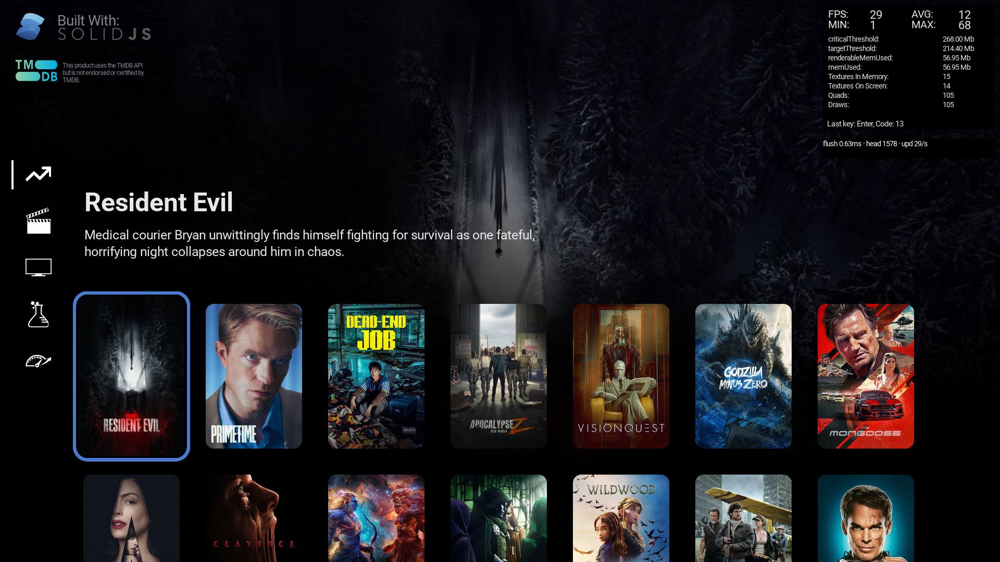

# SolidTV demo — native Roku SceneGraph port

The shared SolidTV demo UI in [`src/`](src/) runs natively on Roku through
SceneGraph 2.0. There is **no WebView, DOM canvas or Roku-specific redesign**:
the same SolidJS + `@solidtv/solid` pages, components, styles and theme are
rendered by the host in [`roku-native/`](roku-native/) at 1920×1080.



## Current verification

| Suite | Result |
|---|---|
| Feature matrix | **56/56 routes, 8/8 interactions** (including held-key repeat, scroll, player transitions, Home recovery) |
| Unit tests | **62/62** |
| 100-cycle stress | **100/100**, memory 53.6–80.4 MB, textures 0–42 |
| Navigation performance | Browse flush p95 **4.11 ms**, 56.9 updates/s; ComplexFlex p95 **2.68 ms** |
| Launch | dev-channel median/p95 **7.66 / 7.79 s** (release packaging is still a target) |
| Task thread | `workerTest=1` returns **`worker: worker-ok`** on the TCL OS 16 device |
| Visual parity | **48/48 comparable static routes pass**; 0 known gaps, 5 dynamic, 1 external, 2 capability |

Run everything from `roku-native/` with `ROKU_DEV_CONFIG_PATH` set to the device
store; the web half of the visual matrix needs
`vite --host 127.0.0.1 --port 5173 --mode offline` and `CHROME_BIN`.

## What works

- Browse, Movies/TV filters, Examples portal, Details, nested Text page and
  the custom keyboard.
- D-pad and held-key navigation, focus restore, back navigation, scrolling
  and long lists.
- Native HLS playback, pause, seek and exit.
- Live TMDB data (backdrops, posters, titles, metadata) on device when a local
  v4 read token is present; otherwise deterministic offline fixtures.
- The FPS/memory panel (memory limits and usage are live; frame telemetry is
  described below).
- Web baseline uses the v2 renderer (`@solidtv/renderer` 2.0.7 /
  `@solidtv/solid` 1.7.1), the same versions the native host targets.

## Repository layout

- `src/` — the shared demo UI (pages, components, styles, theme). The parity
  work keeps its rendering fixes shared: backdrop handling, restore-on-destroy,
  deferred create/destroy fades, and initial Flex row scrolling.
- `roku-native/` — the native host:
  - `src/components/my-first-app.tsx` — host entry; installs browser services,
    loads fonts, sets the renderer factory, imports the shared app, wires keys.
  - `src/roku/renderer.ts` — `SceneGraphRenderer`: node creation, dirty-flush
    loop, animation ticker, FPS/frame-time metrics, memory info.
  - `src/roku/node.ts` — `RokuNode`: Group + visual, z-order, clipping,
    transforms, CSS half-leading, text layout, posters/SubTexture.
  - `src/roku/fonts.ts`, `text-layout.ts` — font faces, measurement, wrapping.
  - `src/roku/browser-services.ts` — browser-compatible surface, Roku key
    bridge, and the firmware `fetch` → `Request` wrapper.
  - `src/roku/video.ts`, `animation.ts`, `effects.ts`, `events.ts`.
  - `roku-config.ts` — build wiring and the published-framework patches.
  - `HANDOFF.md`, `VERIFICATION.md`, `evidence/` — working log, acceptance
    matrix and selected captures.

## Framework support

The framework-side Roku support is in the public fork
[`vynxc/solid`](https://github.com/vynxc/solid), branch `feat/roku-rsg2`:

- `src/core/lightningInit.ts` — the `setRendererFactory` / `getRendererFactory`
  seam that lets a host install a native backend instead of `RendererMain`.
- `src/core/elementNode.ts` — descriptor property loops use `.forEach`
  instead of `for…of`; Roku’s JS engine does not give every `for…of` iteration
  its own binding, which otherwise collapsed every width/height/x/y write into
  `wordWrap`.

The demo targets the published `@solidtv/solid` 1.7.1. Because that release
predates the seam, `roku-native/roku-config.ts` applies equivalent build-time
patches (renderer boundary, descriptor loops, FPSCounter idle handling), so the
demo builds without a framework checkout. Use the fork branch for a clean,
no-patch framework build.

## Prerequisites

- Node 24+, pnpm via corepack.
- A Roku in developer mode with the `rk` CLI (2.19+).
- `mksquashfs` on `PATH` (Debian bookworm squashfs-tools 4.5.1 works).
- A device store JSON for `rk` (see the `rk` documentation), exported as
  `ROKU_DEV_CONFIG_PATH`.

## Setup

```sh
pnpm install
cd roku-native
pnpm install
```

### Live TMDB (optional)

The shared API expects a **v4 read access token** (the long JWT starting
`eyJ...`), not the 32-character v3 API key. Create the gitignored key file:

```sh
cp src/api/key.example.ts src/api/key.ts
# edit src/api/key.ts and replace the placeholder
```

`src/api/key.ts` is in `.gitignore`. Never commit it. The Roku build uses live
TMDB when that file exists; without it, `roku-config.ts` substitutes the
deterministic fixture API (`roku-native/src/offline-api.ts`) automatically.

The web demo (`pnpm start`) requires the key file as well, because
`src/api/index.ts` imports it directly.

## Build / typecheck / deploy

```sh
cd roku-native
node_modules/.bin/tsc --noEmit -p tsconfig.json

PATH="…/usr/bin:$PATH" \
ROKU_DEV_CONFIG_PATH="/path/to/device-store.json" \
node_modules/.bin/rk build --local

PATH="…/usr/bin:$PATH" \
ROKU_DEV_CONFIG_PATH="/path/to/device-store.json" \
node_modules/.bin/rk dev --local --no-build --sideload --bump-build --out-dir dist-build
```

`--out-dir dist-build` is required; without it `rk dev` sideloads the older
`dist-dev` bundle. The build patches the published `@solidtv/solid` copy:
it rewrites the descriptor `for…of` loops to `forEach` (Roku’s JS engine does
not give each iteration its own binding) and substitutes the renderer boundary.

## Verification snapshot

- Typecheck: 0 errors; `rk build --local` reports “Type checks passed”.
- Live TMDB Browse on device: real backdrop, posters and metadata.
- 50-cycle Browse → Details → Examples matrix on the live build and on the
  fixture build: no crash; memory plateaus; textures stay bounded.
- Web reference captures at 1920×1080 for Browse, Examples, Details and Login.
- Keyboard action keys render at full width with labels; Play/Resume, HD/CC
  badges and sidebar labels are vertically centred.
- Evidence: [`roku-native/evidence/`](roku-native/evidence/) and the matrix
  logs [`matrix-50-cycles-live.txt`](roku-native/evidence/matrix-50-cycles-live.txt)
  / [`matrix-50-cycles-offline.txt`](roku-native/evidence/matrix-50-cycles-offline.txt).

### FPS / frame-time metrics

The shared panel shows the **actual produced dirty-update rate**: 29/s while
navigating and 1/s at idle (the panel/perf line itself produces one update).
Frame-time headroom is shown separately in the native diagnostics line under
the panel:

```text
flush 0.63ms · head 1578 · upd 29/s
```

`fpsUpdate` carries `updates`, `avgFlushMs`, `maxFlushMs` and `capacityFps`;
`ROKU_PERF` logs the same in builds that keep `console`. The panel is not
panel refresh — the compositor refreshes independently.

## Roku architecture and APIs

The Roku-specific layer is documented in
[`roku-native/ARCHITECTURE.md`](roku-native/ARCHITECTURE.md):

- **Video:** `src/roku/video.ts` is a typed SceneGraph Video/ContentNode player
  with play/pause/seek, media-key mapping, position/duration in seconds and
  explicit attach/detach.
- **Background work:** `src/roku/tasks.ts` is a priority, time-sliced
  TypeScript queue; `WorkerTask.xml`/`.brs` plus `src/roku/worker-task.ts`
  run a real SceneGraph Task thread for BRS/network work. TypeScript CPU work
  cannot run inside a Task; use the cooperative queue for that.
- **Render loop:** a dirty-driven flush with an 8 ms budget so complex screens
  yield instead of blocking input/animation.

## Automated tests

The native host exposes a test/deep-link hook: an ECP launch/input
`contentId` such as `{"contentId":"/examples"}` drives the shared hash router.
Normal remote-driven use is unchanged.

- **Feature matrix** (`test/feature-matrix.mjs`) — launches every route,
  verifies the active route label, expected page markers, memory/texture
  bounds and (for failures or visual-only pages) a screenshot. It also runs
  Browse → Details → Back, Examples → tile → Back, Login rendering, Infinite
  list D-pad stress and Player media-state checks.
  ```sh
  ROKU_DEV_CONFIG_PATH=/path/to/device-store.json \
    node test/feature-matrix.mjs --device <ROKU_IP>
  # add --screens to capture every route, --only <substr> for one route
  ```
  Reports: `evidence/matrix/matrix-report.{json,md}`; failing captures are in
  `evidence/matrix/failures/`.
- **Long-run stress** (`test/stress-matrix.mjs`) — 100 cycles of
  Browse → Details → Examples → Browse on one app instance, sampling
  memory/FPS/textures.
  ```sh
  ROKU_DEV_CONFIG_PATH=/path/to/device-store.json \
    node test/stress-matrix.mjs --device <ROKU_IP> --cycles 100
  ```
  Report: `evidence/stress/stress-report.{json,md}`.
- **Visual parity matrix** (`test/visual-matrix.mjs`) — starts web in
  `vite --mode offline` and the native fixture build, captures every route,
  masks the FPS/perf panel and reports RMSE + changed-pixel percentage. Full
  frames for failures are in `evidence/visual/failures/`.
  ```sh
  # web: vite --host 127.0.0.1 --port 5173 --mode offline
  CHROME_BIN=... node test/visual-matrix.mjs --device <ROKU_IP>
  ```
- **Performance benchmark** (`test/perf-benchmark.mjs`) — launch-time median
  and p95, navigation flush-time p95, update rate, memory and textures on
  Browse and ComplexFlex.
  ```sh
  node test/perf-benchmark.mjs --device <ROKU_IP>
  ```
  Report: `evidence/performance/perf-report.{json,md}`.
- **Unit tests** (`test/unit/`) — text layout (wrap, ellipsis, line-height,
  vertical alignment, letter spacing), MSDF/web line-box metrics, animation,
  colours/effects, fixtures, key bridge, video, cooperative queue and the
  SceneGraph WorkerTask bridge.
  ```sh
  # from the repository root
  node_modules/.bin/vitest run roku-native/test/unit
  ```

Both matrix tools use the deterministic fixture build (no `src/api/key.ts`);
add a v4 token locally for a live-data run. Screenshots are captured only for
failures and visual-only pages by default, so the automated pass is fast and
the operator only inspects suspicious results. Visual-only pages are also
checked against expected SceneGraph colours (for example the viewport ball),
so an intentionally black page is not mistaken for a blank one.

## Renderer approximations

The visual matrix reports **48/48 static routes passing with no known-gap
classifications**. The remaining limits are implementation notes, logged where
they matter:

- Roku OS 16's `Effect` node has no DropShadow fields. Shadows use two
  pre-blurred Poster presets (soft/focus) tinted with the shader's shadow
  colour; arbitrary blur/spread values use the nearest preset.
- Corner gradients use pre-rendered exact textures for the combinations the
  shared demos use; unknown combinations fall back to bands.
- Text is drawn with the TTF while the web draws MSDF. Line breaks and line
  boxes match; glyph rasterisation is not pixel-identical, so a few text/image
  routes have documented RMSE allowances.
- KTX is decoded at build time into PNG previews (Poster has no runtime KTX
  decoder); the texture page reports `ROKU_TEXTURE_GAP`.
- `holePunch`/`radialProgress` need other primitives; per-side border widths
  collapse to the widest side; non-circular radial-gradient radii are
  approximated per axis; a Label cannot take an `Effect`; unknown `SubTexture`
  sheets log a gap and fall back; `letterSpacing` is measured but not drawn;
  rotated clipping uses the unrotated rect.
- `memoryInfo()` thresholds are approximate (channel limits are real).
  Player video-plane captures are black by design (ECP and headless Chrome);
  verify with `/query/media-player`.

## Credits

Shared demo and SolidTV runtime: the SolidTV project and contributors.
Roku SceneGraph host: the native port in `roku-native/`. License: MIT (see
[`LICENSE`](LICENSE)).
